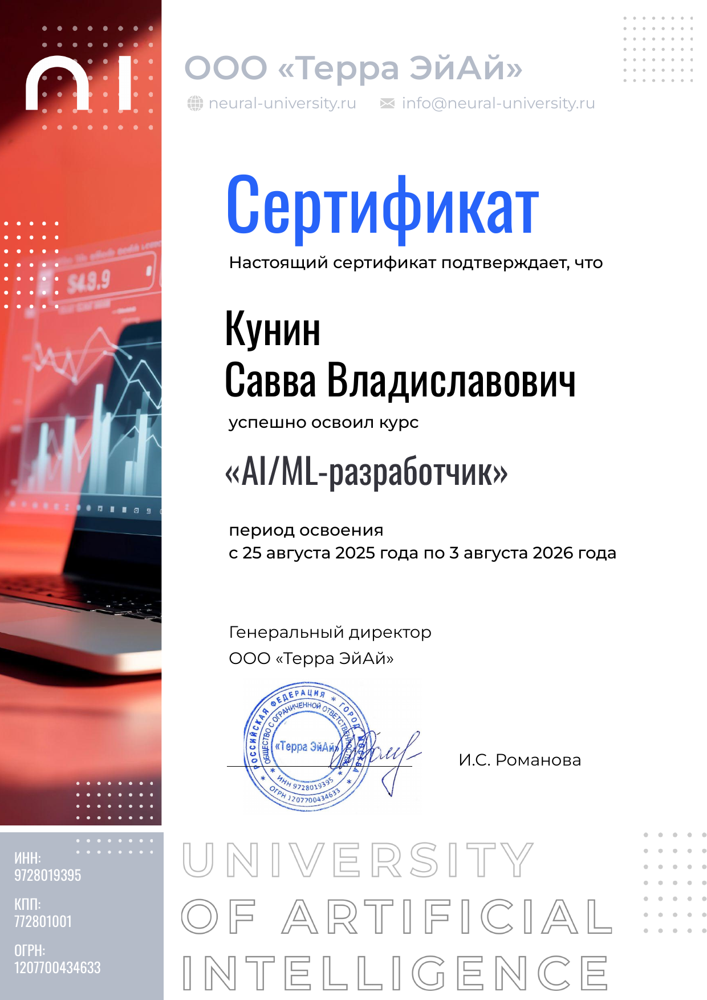

## 🎓 Обучение и сертификаты

Прошёл полный курс **AI/ML-разработчика** в Neural University.

Изучал нейронные сети, Python, ML/NLP, Computer Vision, LLM, production-интеграции, AutoML, Telegram-ботов, AI-web-приложения, работу с серверами и прикладные AI-инструменты для бизнеса.

  

  

  AI/ML-разработчик · Neural University · 2025–2026

